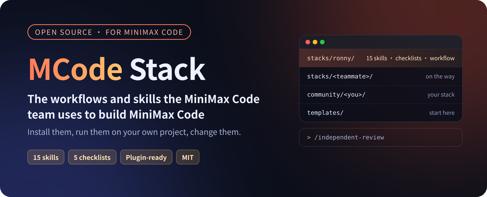
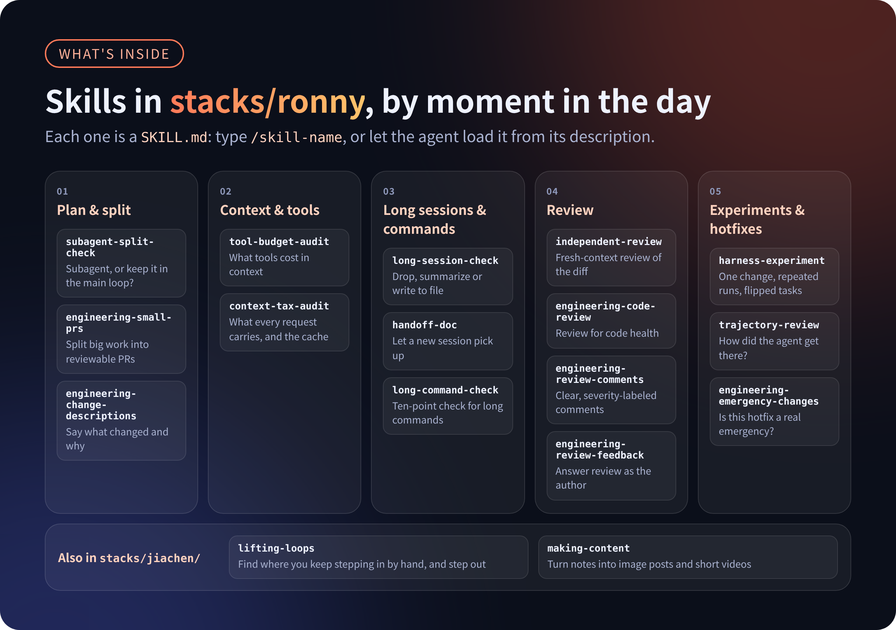
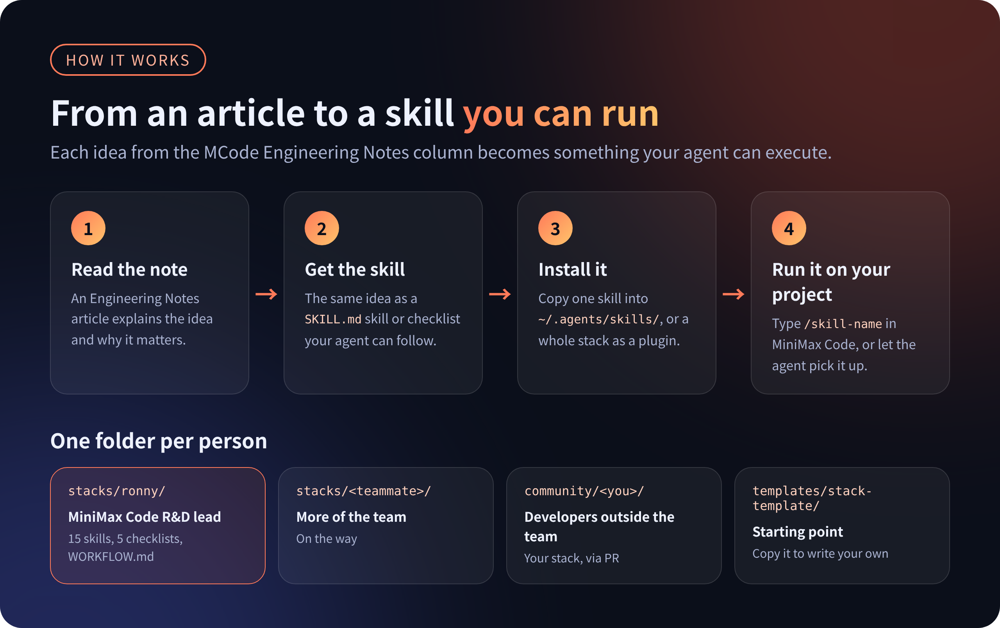

<p align="center">
  
</p>

<p align="center">
  <a href="LICENSE"></a>
  <a href="https://github.com/MiniMax-AI/mcode-stack/actions/workflows/validate.yml"></a>
  <a href="stacks/"></a>
  <a href="https://github.com/MiniMax-AI/minimax-code"></a>
</p>

<p align="center"><b>English</b> · <a href="README_ZH.md">中文</a></p>

**The workflows and skills the MiniMax Code team uses to build MiniMax Code. Open source, install and use.**

This is not a prompt collection or a list of "best practices". It is what
people on the team actually use every day: how to keep AI-written code at a
high bar, how to decide whether a task should go to a subagent, how long to
wait on a long command, how to keep long sessions from going dull, and what
goes into context on every turn. Each piece is a `SKILL.md` skill or
checklist that installs straight into
[MiniMax Code](https://github.com/MiniMax-AI/minimax-code).

- [Quick start](#quick-start)
- [What's inside](#whats-inside)
- [How it works](#how-it-works)
- [Articles](#articles)
- [Stacks](#stacks)
- [Contribute your own stack](#contribute-your-own-stack)

## Quick start

**Claude Code, one command.** The command adds this marketplace and installs
a whole stack. In a shell:

```bash
claude plugin install ronny --marketplace MiniMax-AI/mcode-stack
```

Inside a Claude Code session:

```bash
/plugin install ronny --marketplace MiniMax-AI/mcode-stack
```

Use `jiachen` in place of `ronny` for that stack. From a clone of this
repository, `scripts/install.sh` installs `ronny` (`scripts/install.sh jiachen`
for that stack) with `claude` or `codex` when either is on `PATH`, and
otherwise copies that stack's skills into `~/.agents/skills/`.

Older Claude Code can add the marketplace first, then install:

```bash
/plugin marketplace add MiniMax-AI/mcode-stack
/plugin install ronny@mcode-stack
```

**Codex.** Add the marketplace, then install from the Plugins Directory or the
CLI:

```bash
codex plugin marketplace add MiniMax-AI/mcode-stack
codex plugin add ronny@mcode-stack
```

Substitute `jiachen` the same way. To take a single skill instead of the
plugin, copy that skill's folder into `~/.agents/skills/`. Codex and MiniMax
Code both scan that directory; the copy steps are below.

**One skill, for all your projects:**

```bash
git clone https://github.com/MiniMax-AI/mcode-stack.git ~/mcode-stack
mkdir -p ~/.agents/skills
cp -R ~/mcode-stack/stacks/ronny/skills/long-command-check ~/.agents/skills/
```

Open a new session and type `/skills` in MiniMax Code to see it. Run it with
`/long-command-check`, or let the agent load it from its description.

**The whole stack, as a plugin:**

```bash
mcode plugin marketplace list    # shows your local plugin directory
```

Copy the whole `stacks/ronny` directory into that directory, then open
`/plugins` in MiniMax Code and press `Ctrl+R` to refresh. A local plugin is
installed as soon as it is in that directory; press Space in the panel to
enable or disable it.

**Every stack, from the MiniMax Code marketplace:**

This repository is also a plugin marketplace, so you can install a stack
without copying files and pick up updates later. In MiniMax Code desktop, open
**Plugins**, choose **Add marketplace** and enter `MiniMax-AI/mcode-stack`; each
stack then shows up as one plugin you can install, update or uninstall. Adding
marketplaces is rolling out gradually, so your version may not have it yet.

<details>
<summary>More install options</summary>

MiniMax Code discovers skills in these directories (one subdirectory per
skill, containing `SKILL.md`):

- For the current project only: `.minimax/skills/`, `.claude/skills/` or
  `.agents/skills/` in the project
- For all projects: `~/.agents/skills/` (`~/.claude/skills/` and
  `~/.codex/skills/` are read too)

`mcode plugin add` installs from the official catalog only; it does not take
a GitHub URL or a local path.

The skills use the common `SKILL.md` format, so most of them also work in
other agents that support skills.

</details>

## What's inside

<p align="center">
  
</p>

| When | Skill | What it does |
| --- | --- | --- |
| Plan & split | [`subagent-split-check`](stacks/ronny/skills/subagent-split-check/SKILL.md) | Decide whether work goes to a subagent or stays in the main loop |
| | [`engineering-small-prs`](stacks/ronny/skills/engineering-small-prs/SKILL.md) | Split large features, refactors and migrations into small reviewable PRs |
| | [`engineering-change-descriptions`](stacks/ronny/skills/engineering-change-descriptions/SKILL.md) | Write PR and commit descriptions that say what changed and why |
| Context & tools | [`tool-budget-audit`](stacks/ronny/skills/tool-budget-audit/SKILL.md) | Measure what tools cost in context; trim, tool search or programmatic tool calling |
| | [`context-tax-audit`](stacks/ronny/skills/context-tax-audit/SKILL.md) | What gets injected into every request, and what it does to the prompt cache |
| Long sessions & commands | [`long-session-check`](stacks/ronny/skills/long-session-check/SKILL.md) | Drop, summarize or write to file; compact or start fresh; memory scoping |
| | [`handoff-doc`](stacks/ronny/skills/handoff-doc/SKILL.md) | A hand-off doc so a new session can pick up the work |
| | [`long-command-check`](stacks/ronny/skills/long-command-check/SKILL.md) | Ten-point audit of long shell commands and background tasks |
| Review | [`independent-review`](stacks/ronny/skills/independent-review/SKILL.md) | Review a diff from a clean context: only diff, requirement and test results |
| | [`engineering-code-review`](stacks/ronny/skills/engineering-code-review/SKILL.md) | Review a change for code health: design, functionality, complexity, tests, approval risk |
| | [`engineering-review-comments`](stacks/ronny/skills/engineering-review-comments/SKILL.md) | Write clear, severity-labeled review comments that explain the reasoning |
| | [`engineering-review-feedback`](stacks/ronny/skills/engineering-review-feedback/SKILL.md) | Handle reviewer comments as the author: fix, clarify, resolve disagreements |
| Experiments & hotfixes | [`harness-experiment`](stacks/ronny/skills/harness-experiment/SKILL.md) | Small eval, one change at a time, repeated runs, look at flipped tasks |
| | [`trajectory-review`](stacks/ronny/skills/trajectory-review/SKILL.md) | Look at how the agent got its result, not only whether it passed |
| | [`engineering-emergency-changes`](stacks/ronny/skills/engineering-emergency-changes/SKILL.md) | Decide whether a hotfix is a real emergency and run expedited review safely |

The table above is [`stacks/ronny`](stacks/ronny/).
[`stacks/jiachen`](stacks/jiachen/) adds
[`lifting-loops`](stacks/jiachen/skills/lifting-loops/SKILL.md), which finds
the loops where you keep acting as a manual step for your agents and lifts you
out of them, and [`making-content`](stacks/jiachen/skills/making-content/SKILL.md),
which turns notes and material into Xiaohongshu image posts and short vertical
videos.

A stack usually has three kinds of things:

| Kind | What it is | How to use it |
| --- | --- | --- |
| Skill | A directory with a `SKILL.md` | Invoke it in MiniMax Code with `/<skill-name>`, or let the agent load it from its description |
| Checklist | Also a skill: the agent walks your project item by item. A plain-text copy lives in `checklists/` | Same as above, or just read it |
| Workflow | A `WORKFLOW.md` describing how this person works with MiniMax Code every day | Read it |

## How it works

<p align="center">
  
</p>

AI writes code faster every month. What separates results now is the layer
of engineering habits around the agent: when to make it stop and check its
own work, who reviews, where state lives, what counts as a real experiment.
Those habits are hard to follow from an article, so we turned them into
skills and checklists. They pair with our *MCode Engineering Notes* column:
the article explains the idea, this repository makes it runnable.

We also believe harness engineering is a craft that moves forward by
experiment. Everything here will keep changing as we learn. Take it, change
it, and send your version back.

## Articles

| # | MCode Engineering Notes | Companion skills |
| --- | --- | --- |
| 01 | [More subagents isn't better: manage context first, then parallelize](notes/01-subagent.md) | `independent-review`, `subagent-split-check`, `harness-experiment` |
| 02 | [Too many tools will eat your context: from tool search to PTC](notes/02-tool-context.md) | `tool-budget-audit` |
| 03 | [Keeping long sessions sharp: compaction vs. memory](notes/03-compaction-memory.md) | `long-session-check`, `handoff-doc` |
| 04 | [How long should one bash command wait: from foreground blocking to background tasks](notes/04-bash-background.md) | `long-command-check` |
| 06 | [The hidden tax on every turn: what an agent puts into context](notes/06-context-tax.md) *(upcoming)* | `context-tax-audit` |

## Stacks

```text
stacks/ronny/               Ronny's stack (MiniMax Code R&D lead), the first and most complete one
stacks/jiachen/             Jiachen's stack: getting out of the agent loop, and turning notes into posts and videos
stacks/<name>/              One directory per team member; teammates are welcome to add theirs
notes/                      Which runnable piece goes with each Engineering Notes article
community/                  Stacks contributed by developers outside the team
templates/stack-template/   Start here to write your own stack
```

Every stack is also a MiniMax Code plugin package. See
[`stacks/ronny`](stacks/ronny/) and [`stacks/jiachen`](stacks/jiachen/) for
what each one contains.

## Contribute your own stack

What we most want to see is how you actually work with MiniMax Code, or with
any other agent, day to day.

1. Copy `templates/stack-template/` to `community/<your-id>/`.
2. Write a `WORKFLOW.md`: how you use the agent every day, what you hand to it
   and what you keep an eye on yourself.
3. Add at least one skill or checklist you really use.
4. Run `node scripts/check.mjs`, then open a PR with the output and a short
   record of real usage.

Details in [CONTRIBUTING.md](CONTRIBUTING.md). Using something from here in
your own agent? Tell us with an **I use this** issue.

## Relationship to MiniMax Code

MiniMax Code itself lives in
[MiniMax-AI/minimax-code](https://github.com/MiniMax-AI/minimax-code). This
repository only holds workflows and skills, no MiniMax Code source code.

## License

[MIT](LICENSE), except where a stack's `NOTICE.md` says otherwise. The
`engineering-*` skills are adapted from Google Engineering Practices; the
adapted material stays under CC-BY 3.0. See
[`stacks/ronny/NOTICE.md`](stacks/ronny/NOTICE.md).
