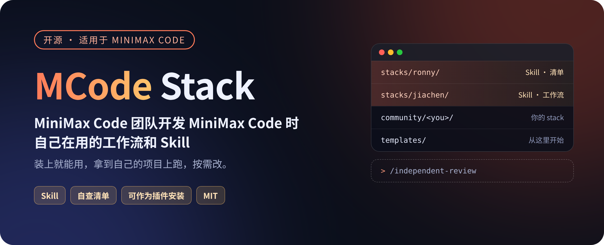
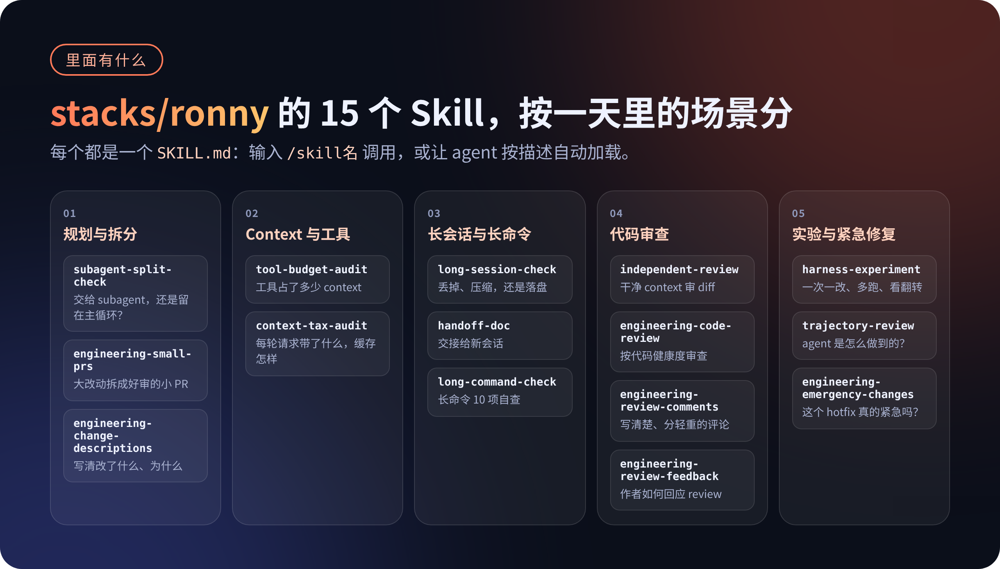
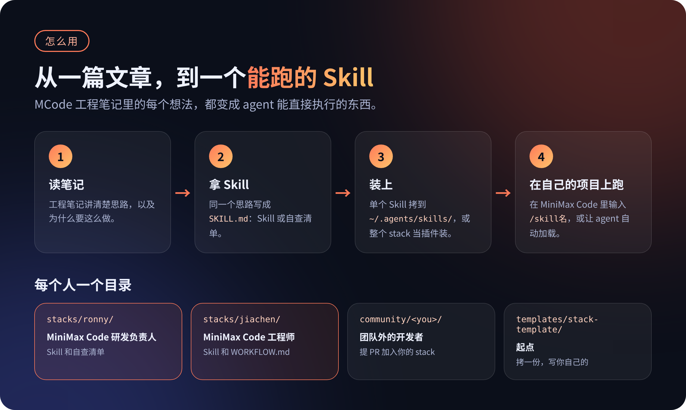

<p align="center">
  
</p>

<p align="center">
  <a href="LICENSE"></a>
  <a href="https://github.com/MiniMax-AI/mcode-stack/actions/workflows/validate.yml"></a>
  <a href="stacks/"></a>
  <a href="https://github.com/MiniMax-AI/minimax-code"></a>
</p>

<p align="center"><a href="README.md">English</a> · <b>中文</b></p>

**我们团队用 MiniMax Code 写 MiniMax Code 的全套工作流，全部开源，装上就能用。**

这里放的不是 prompt 合集，也不是「最佳实践」清单，而是团队成员每天真在用的东西：怎么让 AI 写的代码保持质量、怎么判断一个任务该不该拆 subagent、长命令该怎么等、长会话怎么不变傻、每一轮往上下文里塞了什么。每一份都是一个 `SKILL.md` 格式的 Skill 或清单，能直接装进 [MiniMax Code](https://github.com/MiniMax-AI/minimax-code) 里用。

- [快速开始](#快速开始)
- [里面有什么](#里面有什么)
- [怎么用起来](#怎么用起来)
- [工程笔记](#工程笔记)
- [Stacks](#stacks)
- [参与贡献](#参与贡献)

## 快速开始

**Claude Code，一条命令。** 这条命令会加上本仓库的插件市场，并装上一整份 stack。在 shell 里：

```bash
claude plugin install ronny --marketplace MiniMax-AI/mcode-stack
```

在 Claude Code 会话里：

```bash
/plugin install ronny --marketplace MiniMax-AI/mcode-stack
```

装 Jiachen 的 stack 时，把 `ronny` 换成 `jiachen`。克隆本仓库后可以跑 `scripts/install.sh`（默认 `ronny`，或 `scripts/install.sh jiachen`）：`PATH` 里有 `claude` 或 `codex` 时，它会执行同样的安装，否则把该 stack 的 Skill 复制到 `~/.agents/skills/`。

较旧的 Claude Code 可以先加市场，再安装：

```bash
/plugin marketplace add MiniMax-AI/mcode-stack
/plugin install ronny@mcode-stack
```

**Codex。** 先加上市场，再从 Plugins Directory 或 CLI 安装：

```bash
codex plugin marketplace add MiniMax-AI/mcode-stack
codex plugin add ronny@mcode-stack
```

把 `ronny` 换成 `jiachen` 即可。如果只要某一个 Skill，把它的目录复制到 `~/.agents/skills/`。Codex 和 MiniMax Code 都会扫描这个目录，复制步骤见下文。

**装一个 Skill，所有项目都能用：**

```bash
git clone https://github.com/MiniMax-AI/mcode-stack.git ~/mcode-stack
mkdir -p ~/.agents/skills
cp -R ~/mcode-stack/stacks/ronny/skills/long-command-check ~/.agents/skills/
```

重新打开会话后，在 MiniMax Code 里输入 `/skills` 就能看到它。用 `/long-command-check` 调用，或者让 agent 按描述自动加载。

**整份 stack 当插件装：**

```bash
mcode plugin marketplace list    # 查看本地插件目录
```

把 `stacks/ronny` 整个目录复制到那个目录下，然后在 MiniMax Code 里打开 `/plugins`，按 `Ctrl+R` 刷新。本地插件放进去就算装好了，可以在面板里按空格启用或停用。

**从 MiniMax Code 插件市场安装：**

这个仓库本身也是一个插件市场，不用复制文件就能装，之后有更新也能直接拿到。在 MiniMax Code 桌面端打开「插件」，点「添加市场」，填入 `MiniMax-AI/mcode-stack`，每份 stack 都会显示成一个插件，可以安装、更新或卸载。添加市场的功能正在逐步开放，你的版本可能还没有。

<details>
<summary>更多安装方式</summary>

MiniMax Code 会自动发现这几个目录里的 Skill（每个 Skill 一个子目录，里面放 `SKILL.md`）：

- 只对当前项目生效：项目里的 `.minimax/skills/`、`.claude/skills/` 或 `.agents/skills/`
- 对所有项目生效：`~/.agents/skills/`（`~/.claude/skills/`、`~/.codex/skills/` 也会读取）

`mcode plugin add` 只从官方插件目录安装，不接受 GitHub 地址或本地路径。

这里的 Skill 用的是通用的 `SKILL.md` 格式，大部分也能放进其他支持 Skill 的 agent 里用。

</details>

## 里面有什么

<p align="center">
  
</p>

| 场景 | Skill | 做什么 |
| --- | --- | --- |
| 规划与拆分 | [`subagent-split-check`](stacks/ronny/skills/subagent-split-check/SKILL.md) | 判断一段活该交给 subagent，还是留在主循环 |
| | [`engineering-small-prs`](stacks/ronny/skills/engineering-small-prs/SKILL.md) | 把大功能、大重构、迁移拆成一串好审的小 PR |
| | [`engineering-change-descriptions`](stacks/ronny/skills/engineering-change-descriptions/SKILL.md) | 写清楚改了什么、为什么改的 PR 和 commit 描述 |
| Context 与工具 | [`tool-budget-audit`](stacks/ronny/skills/tool-budget-audit/SKILL.md) | 算清工具吃了多少 context，决定先精简、上 tool search 还是上 PTC |
| | [`context-tax-audit`](stacks/ronny/skills/context-tax-audit/SKILL.md) | 每轮往请求里塞了什么，会不会弄坏提示词缓存 |
| 长会话与长命令 | [`long-session-check`](stacks/ronny/skills/long-session-check/SKILL.md) | 该丢的丢、该压的压、该落盘的落盘；什么时候压缩，什么时候开新会话 |
| | [`handoff-doc`](stacks/ronny/skills/handoff-doc/SKILL.md) | 写一份交接文档，新会话接着干 |
| | [`long-command-check`](stacks/ronny/skills/long-command-check/SKILL.md) | 长命令和后台任务的 10 项自查 |
| 代码审查 | [`independent-review`](stacks/ronny/skills/independent-review/SKILL.md) | 审查者从干净的 context 开始，只拿 diff、需求说明和测试结果 |
| | [`engineering-code-review`](stacks/ronny/skills/engineering-code-review/SKILL.md) | 按代码健康度审查改动：设计、功能、复杂度、测试、能不能批 |
| | [`engineering-review-comments`](stacks/ronny/skills/engineering-review-comments/SKILL.md) | 写清楚、标好严重程度、讲明理由的 review 评论 |
| | [`engineering-review-feedback`](stacks/ronny/skills/engineering-review-feedback/SKILL.md) | 作为作者处理 review 意见：改代码、补说明、化解分歧 |
| 实验与紧急修复 | [`harness-experiment`](stacks/ronny/skills/harness-experiment/SKILL.md) | 小 eval、一次只改一处、多跑几次、看哪些任务翻转了 |
| | [`trajectory-review`](stacks/ronny/skills/trajectory-review/SKILL.md) | 不只看结果过没过，回头看 agent 是怎么得到这个结果的 |
| | [`engineering-emergency-changes`](stacks/ronny/skills/engineering-emergency-changes/SKILL.md) | 判断 hotfix 是不是真紧急，紧急时怎么快审又不丢质量 |

上表是 [`stacks/ronny`](stacks/ronny/) 的内容。[`stacks/jiachen`](stacks/jiachen/) 里还有：[`lifting-loops`](stacks/jiachen/skills/lifting-loops/SKILL.md) 找出你总在给 agent 当「人工环节」的那些循环，帮你从里面抽身；[`making-content`](stacks/jiachen/skills/making-content/SKILL.md) 把笔记和素材做成小红书图文和竖版短视频。

每个 stack 里一般有三类东西：

| 类型 | 是什么 | 怎么用 |
| --- | --- | --- |
| Skill | 一个目录，里面有 `SKILL.md` | 装好后在 MiniMax Code 里用 `/skill名` 调用，或者让 agent 按描述自动加载 |
| 清单 | 也做成 Skill，让 agent 拿着清单逐条对照你的项目；`checklists/` 下另有纯文本版 | 同上，或者直接读 |
| 工作流说明 | 一份 `WORKFLOW.md`，写清这个人每天怎么用 MiniMax Code 干活 | 直接读 |

## 怎么用起来

<p align="center">
  
</p>

AI 写代码越来越快，真正拉开差距的，是围绕 agent 的那一圈工程习惯：什么时候让它停下来自查，review 交给谁，状态记在哪，实验怎么做才算数。这些东西写在文章里很难照着做，所以我们把它们做成了 Skill 和清单，和「MCode 工程笔记」专栏对应：文章把道理讲清楚，仓库负责落地。

我们也相信，harness 工程是一门靠实验推进的手艺。这里的每一份东西都会随着我们的实践继续改。欢迎拿去用、拿去改。想改仓库里的内容，先开 issue，见[参与贡献](#参与贡献)。

## 工程笔记

| # | MCode 工程笔记 | 对应 Skill |
| --- | --- | --- |
| 01 | [subagent 不是越多越好：先管好 context，再谈并行](notes/01-subagent.md) | `independent-review`、`subagent-split-check`、`harness-experiment` |
| 02 | [工具一多，context 就爆：从 tool search 到 PTC](notes/02-tool-context.md) | `tool-budget-audit` |
| 03 | [长会话怎么不变傻：compaction 和 memory 的取舍](notes/03-compaction-memory.md) | `long-session-check`、`handoff-doc` |
| 04 | [一条 bash 命令该等多久：从前台阻塞到后台任务](notes/04-bash-background.md) | `long-command-check` |
| 06 | [每一轮都在交的隐形税：agent 往上下文里塞了什么](notes/06-context-tax.md)（即将发布） | `context-tax-audit` |

## Stacks

```text
stacks/ronny/               MiniMax Code 研发负责人 Ronny 的日常工作流，第一份，也是目前最完整的一份
stacks/jiachen/             Jiachen 的工作流：把自己从 agent 的循环里解放出来，以及把笔记做成图文和短视频
stacks/<name>/              每位成员一个目录，欢迎团队同事把自己的也放进来
notes/                      「MCode 工程笔记」每一篇对应哪一份能跑的东西
community/                  团队外的 stack，由协作者加进来
templates/stack-template/   新增 stack 用的模板
```

每份 stack 本身也是一个 MiniMax Code 插件包，具体内容见 [`stacks/ronny`](stacks/ronny/) 和 [`stacks/jiachen`](stacks/jiachen/)。

## 参与贡献

欢迎开 issue 讨论。代码、文档和 stack 的 PR，目前只收仓库协作者的。还不是协作者的话，先[开一个 issue](https://github.com/MiniMax-AI/mcode-stack/issues/new/choose) 把想法说清楚。

我们很想知道你用 MiniMax Code（或者别的 agent）每天到底怎么干活，写在 issue 里就行。协作者要把一份 stack 放进仓库，按这几步：

1. 从 `templates/stack-template/` 复制一份到 `community/<你的 id>/`
2. 写一份 `WORKFLOW.md`：你每天怎么用 agent，哪些环节交给它，哪些自己盯着
3. 至少放一个你真在用的 Skill 或清单
4. 本地跑一遍 `node scripts/check.mjs`，再提 PR，附上校验输出和一段真实的使用记录

详细规则见 [CONTRIBUTING_ZH.md](CONTRIBUTING_ZH.md)。如果你把这里的东西用进了自己的 agent，欢迎开一个「I use this」issue 告诉我们。

## 和 MiniMax Code 的关系

MiniMax Code 本体在 [MiniMax-AI/minimax-code](https://github.com/MiniMax-AI/minimax-code)。这个仓库只放工作流和 Skill，不放 MiniMax Code 的代码。

## License

[MIT](LICENSE)，各 stack 的 `NOTICE.md` 另有说明的除外。`engineering-*` 系列 Skill 改编自 Google Engineering Practices，改编部分仍遵循 CC-BY 3.0，详见 [`stacks/ronny/NOTICE.md`](stacks/ronny/NOTICE.md)。
