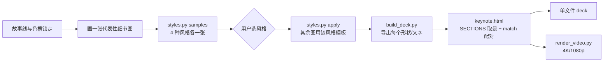

# Magic Move Deck

成品：一个 1920×1080 的单文件 HTML。每一页都是某张图 + 一个相机取景；前后页共享的元素变形、移动过去。图有四种风格，同一套代码（`main()`）可以在任一风格下渲染，所以先出四张样张让用户挑，再按选中的风格做完整 deck。



## 风格

| id | 名称 | 观感 |
|---|---|---|
| `handdrawn` | 手绘 Hand-drawn | rough.js 手绘线条 + 宋体 / Times 印刷字 + 暖米白纸面 |
| `minimal` | 简约 Minimal | 精确几何 + 圆角卡片 + 无衬线 + 近白底 |
| `neon` | 暗色科技 Neon | 深蓝底 + 霓虹描边柔光 + 切角面板 |
| `brutalist` | 新野兽派 Brutalist | 奶油底 + 粗黑描边 + 高饱和平涂 + 硬投影 |

每个风格在 `styles/<id>/`：`diagram.html`（模板）、`STYLE.md`（字体、9 色槽、额外规则）、`preview.png`。`python3 scripts/styles.py list` 列出全部。新增风格见 `references/styles.md`。

## 先读

1. `references/diagram-rules.md` — 与风格无关的画图规则：只画 brief 里的东西、9 个色槽的抽象语义、形状语义、自检清单。
2. `references/magic-move-contract.md` — deck 原则、三类转场、**命名契约**（决定元素能否变过去）、build 挂钩。**画图前必读。**
3. `references/styles.md` — 风格系统：样张、切换、模板接口。
4. `references/bilingual-layout.md`（双语 deck 必读）、`references/cards.md`（封面 / 结束页）、`references/verification.md`（构建输出、截图、视频、分享）。
5. 完整范例 `examples/rag-assistant/`：图源文件 + CONFIG + `previews/`。动手前看 `previews/overview.jpg`、`previews/01_ingestion.jpg`、`previews/00_cover.jpg`，照抄其 `main()` 写法。
6. 用户选定风格后读 `styles/<style>/STYLE.md`。

下文 `$SK` 指本 skill 的目录（`SKILL.md` 所在目录）。

## 硬规则

1. **先样张，后整套。** 四种风格各出一张样张（同一张图），交给用户选；用户选定前不画其余的图、不构建 deck。用户已经指定风格时跳过样张。
2. **素材只来自图。** 不加额外 slide，不在图上叠卡片、提示或页码；要说的画进图里。整套 deck 只用一种风格。
3. **相关元素变形过去，不复制、不整图交叉淡化。** 同一概念在总览和细节图里用同一个名字（节点 = 闭合形状 + 框内文字，名字取第一行加粗中文，否则第一行）；分区用 `frame()` + 标签。
4. **简略 → 详细：** 概念框放大、细节从框里长出；**详细 → 简略：** 细节淡出、缩回概念。细节画在所属概念框内。
5. **helper 一个都不改、不绕开。** 复制 `styles/<style>/diagram.html` 后只改 `main()`；直接用 `ctx` 画的东西进不了 deck。`main()` 里颜色和字体只用模板常量（`C.<slot>`、`LABEL_BG`、`FONT_TI`），这样换风格不用重画。
6. **故事线固定：** `[cv] → ov → (ov 聚焦该区域 → 细节图全图 → 3 个聚光点) × N → ov → [end]`，每个聚光点注释一句结论。
7. **只画 brief 里有的东西**；对外 deck 不写内部服务名 / 代号，用通用名。
8. 生成物与源文件一起提交；改了图跑 `build_deck.py`，只改 `keynote.html` 跑 `build_deck.py --bundle`。

## 工作流

### 1. 规划故事线

先写成清单再动手：

- 总标题（中英）；N 个主题（3–8 个），每个主题一句原则 + 圈号 ①…；每个主题 3 个聚光点各一句结论。
- 哪些概念出现在总览、哪些只在细节图里出现；总览上每个主题对应哪块区域（这块区域就是 `SECTIONS[].ov`）。
- 封面 / 结束页要不要、放什么（团队、分享人、二维码、截图）。
- 语言：双语（英文为主）/ 纯中文 / 纯英文。

### 2. 锁定概念色槽

整套 deck 是一个系列：复制 `templates/diagram-binding.md`，写「概念 → 色槽 → 形状」，之后只追加不改。绑定的是色槽（`C.agent` 等），不是具体颜色，所以和风格无关。范例：`examples/rag-assistant/diagram-binding.md`。

### 3. 建项目

```
<project>/
  overview.html              # 总览 'ov'，大画布（约 16:9，如 2400×1400）
  details/00_cover.html      # 'cv'（可选）
  details/01_<topic>.html …  # 细节图 'd1'…，1920×1080
  details/99_end.html        # 'end'（可选）
  details/assets/            # 卡片用的图片、二维码
  diagram-binding.md
  style-samples/             # 第 4 步的样张（可不提交）
  presentation/              # 拷入 templates/keynote.html 与 scripts/build_deck.py、snapshot_deck.py、render_video.py
```

```bash
mkdir -p presentation details/assets
cp $SK/templates/keynote.html $SK/scripts/{build_deck,snapshot_deck,render_video}.py presentation/
```

### 4. 风格样张（四选一）

1. 挑最能代表这套 deck 的一张细节图（通常是第一个主题），用正式内容画完整：`cp $SK/styles/handdrawn/diagram.html details/01_<topic>.html`，`main()` 从 `templates/detail-main.js` 起步（任一风格模板都行，样张只取 `main()`）。按 `diagram-rules.md` 自检。
2. 渲染四种风格：

   ```bash
   python3 $SK/scripts/styles.py samples details/01_<topic>.html --out style-samples
   ```

   输出 `style-samples/<style>.png`（每种风格一张）和 2×2 的 `contact-sheet.png`（标注 A–D）。
3. 逐张看四张 PNG。某个风格下文字溢出或压线时，调 `main()` 的尺寸、留白（不写死外观），重新渲染，直到四张都干净。
4. 把四张样张发给用户（每种风格一张图，附 `STYLE.md` 的一句话描述），请用户选一种；有提问工具时用选项 A–D 提问。然后**停下等回复**。用户可以要求微调（换卡片品牌色 → `references/cards.md`；全新风格 → `references/styles.md`「新增一个风格」）。

### 5. 应用所选风格

```bash
python3 $SK/scripts/styles.py apply <style> details/01_<topic>.html
```

读 `styles/<style>/STYLE.md`。之后每张图都从 `cp $SK/styles/<style>/diagram.html <file>` 开始，只改尺寸和 `main()`。

### 6. 画总览 `ov`

- 改 `.stage` 和 `<canvas id="c">` 尺寸（宽高比接近 16:9 或稍高；全部主题都要放得下）。
- 左上角 `title()` 是总标题（封面标题的词会飞到这里）。
- 每个主题一块区域：`frame()` 分区，标签带 `ZONES` 关键词；区域内是该主题的概念框。
- 每个主题一个以圈号开头的原则小标题（英文）+ 正下方一行中文，放在**该主题区域（`SECTIONS[].ov`）之外**，如区域上方的一条标题带（见范例总览）。放进区域里，飞向细节图标题时中文行会横穿英文行。
- 总览只放每个概念的名字和最少的细项，细节留给细节图。

### 7. 画其余细节图 `d2…dN`

- 1920×1080，`main()` 从 `templates/detail-main.js` 起步。
- 标题：恰好两次 `title()`，英文以对应圈号开头，再中文（单语 deck 一次）。中文标题与总览小标题下方那行中文**完全相同**，否则两段文字交叉淡化，转场中途看起来是重影。
- 与总览共享的概念用**同名**节点 / 分区；只在细节图出现的内容画在所属概念框里。
- 每张图渲染成 PNG 目检（`diagram-rules.md`「渲染与自检」）。

### 8. 卡片 `cv` / `end`（可选）

`main()` 从 `templates/card-main.js` 起步；颜色来自所选风格的 `C.card`，规则见 `references/cards.md`。卡片标题尽量复用总览标题的词；结束页标题与封面相同。

### 9. 填 CONFIG 并构建

- `presentation/build_deck.py`：`DECK_NAME`、`SOURCES`（键 → 相对项目根的路径；`ov` 必须有）。
- `presentation/keynote.html` CONFIG 块：`SECTIONS`（`d`、总览区域 `ov`、3 个 `spots`，单位都是该图画布像素，坐标从 `main()` 里的绘制坐标读）与 `ZONES`（按你的分区关键词改）；改 `<title>`。底色、字体、发光、封面毛玻璃自动跟随风格，不用改 CSS。
- `presentation/render_video.py`：`VIDEO_NAME`、`hold_seconds()`。

```bash
cd presentation && python3 build_deck.py      # → assets/deck_data.js + <DECK_NAME>.html
```

看每张图的 `nodes` / `keyed` 是否合理（见 `references/verification.md`）。

### 10. 验证

```bash
python3 snapshot_deck.py keynote.html --out /tmp/shots --slides
python3 snapshot_deck.py keynote.html --out /tmp/shots --trans 1-2,2-1,2-3,3-2 --p 0.06,0.2,0.35,0.5
python3 snapshot_deck.py <DECK_NAME>.html --offline
```

逐张看截图：字压字、框穿字、元素该飞没飞（名字没对上）、聚光点取景。改图修正，不改引擎去迁就某张图。完整清单见 `references/verification.md`。

### 11. 交付

把单文件 `presentation/<DECK_NAME>.html` 交给用户（附 2–3 张关键截图）；需要视频时 `python3 render_video.py music.mp3`。部署到任何线上托管前先征得同意（`references/verification.md` §5）。

## 引擎说明

`templates/keynote.html` 只读 `build_deck.py` 导出的数据：项目配置集中在 CONFIG 块（`SECTIONS`、`ZONES`）；`cv` / `end` 可选；圈号 ①–⑳；主题（纸色、字体、形状发光、封面毛玻璃）来自图所用的风格模板。四种风格共享同一引擎和同一套命名契约，换风格不影响配对结果（节点数、节点名不变）。
