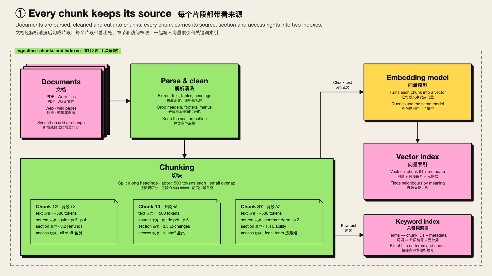

# 新野兽派 Brutalist
<!-- order: 4 -->
> 奶油底 + 粗黑描边 + 高饱和平涂 + 硬投影 + 粗体无衬线，像独立杂志或潮流海报

适合：创意提案、产品故事、社区分享、年轻受众；需要「一眼记住」的场合。

## 视觉要素

| 要素 | 取值 |
|---|---|
| 背景 | 奶油色 `#f4efe4` |
| 形状 | `roughness 0`、直角、粗黑描边（约为手绘风的 1.15 倍）、高饱和平涂；框右下 7px 黑色硬投影 |
| 字体 | Helvetica Neue / Arial 粗体，中文 PingFang SC / 微软雅黑 / Noto Sans SC |
| 箭头 | 黑色粗线 + 大号实心三角 |
| 分区框 | 黑色长虚线；标签是填该分区颜色的色块 |
| 文字色 | 框内文字 = 描边 = 黑色（`C.error` 例外：红描边红字） |
| 卡片 | 黑框奶白卡 + 黑色硬投影；毛玻璃为橙 → 黄 → 奶油渐变 |

## 9 个色槽

本风格所有槽描边都是 `#111111`，靠填充色区分概念；`C.error` 用红色描边。

| 槽 | 描边 = 框内文字 | 填充 | 对比度 |
|---|---|---|---|
| `C.user` | `#111111` | `#8ecbff` 天蓝 | 10.9 |
| `C.im` | `#111111` | `#6fe3c8` 薄荷 | 12.1 |
| `C.agent` | `#111111` | `#ff9248` 橙 | 8.5 |
| `C.subagent` | `#111111` | `#ffd84d` 黄 | 13.7 |
| `C.llm` | `#111111` | `#bda6ff` 薰衣草 | 9.0 |
| `C.tools` | `#111111` | `#9be870` 草绿 | 12.7 |
| `C.memory` | `#111111` | `#ffa8d5` 粉 | 10.6 |
| `C.external` | `#111111` | `#ddd6c6` 石色 | 13.0 |
| `C.error` | `#c8102e` 红 | `#ffe0e0` | 4.8 |

通用色：箭头 `#111111`，标题 `#111111`，副标题 `#3d3a35`，注释 `#5b574f`。

## 本风格的额外规则

- `box()` 先画投影（同描边色、黑色填充、偏移 7px）再画框：两者是连续绘制、同描边、高度重叠的闭合形状，`build_deck.py` 按「堆叠框」把它们当同一个节点，转场时一起移动。不要在投影和框之间插入别的绘制。
- 所有槽描边相同，颜色是概念的唯一视觉线索之一：每个框都必须有文字；分区标签色块帮读者对应分区颜色。
- 粗体无衬线比 Times 宽：框内英文留 10–15% 余量。
