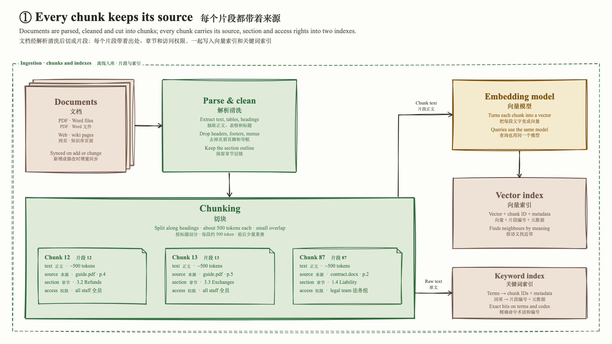

# 手绘 Hand-drawn
<!-- order: 1 -->
> rough.js 手绘线条 + 宋体 / Times 印刷字 + 暖米白纸面，像教科书插图或白板草图

适合：技术分享、架构讲解、内部培训、公众号配图风格的 deck。观感亲和、不像「PPT」。

模板改编自 [handdrawn-diagram](https://github.com/TrentChou/handdrawn-diagram)（MIT）。

## 视觉要素

| 要素 | 取值 |
|---|---|
| 背景 | 暖米白 `#fdfdfa`（不用纯白） |
| 形状 | rough.js 手绘：`roughness 1.6`、`bowing 1.4`、描边 2.4px、`solid` 浅色填充 |
| 字体 | 中文宋体 / 中宋（Songti SC · STZhongsong · SimSun · Noto Serif SC），拉丁 Times New Roman |
| 箭头 | 暖墨色 `#3a3530` 手绘线 + 两笔箭头 |
| 分区框 | 4 条手绘虚线，标签压在上边线、带纸色底 |
| 强调 | 主角框加大 1.3–1.5 倍、描边 3–3.2px，不靠更亮的颜色 |
| 卡片 | 钢蓝描边、半透明纸色填充；毛玻璃为钢蓝 → 纸色渐变 |

## 9 个色槽

| 槽 | 描边 = 框内文字 | 填充 | 对比度 |
|---|---|---|---|
| `C.user` | `#1f5582` 钢蓝 | `#e3ebf2` | 6.5 |
| `C.im` | `#106668` 墨青 | `#dde8e7` | 5.4 |
| `C.agent` | `#a04a1f` 砖橙 | `#f3e2cf` | 4.7 |
| `C.subagent` | `#7d4f0a` 焦糖 | `#f4eacd` | 5.8 |
| `C.llm` | `#4a3f8c` 靛紫 | `#e6e2ef` | 6.9 |
| `C.tools` | `#2f6b3c` 苔绿 | `#dfead9` | 5.1 |
| `C.memory` | `#6e554a` 栗棕 | `#ede2d5` | 5.4 |
| `C.external` | `#4f5359` 墨灰 | `#e9e7e3` | 6.3 |
| `C.error` | `#a52928` 砖红 | `#f0d8d2` | 5.2 |

通用色：箭头 `#3a3530`，标题 `#2a2520`，副标题 `#5a544f`，注释 `#7a746e`（对底色 4.5:1，不要再调浅）。

## 本风格的额外规则

- 字体只用宋体 / 中宋 + Times New Roman。不用黑体 / 无衬线，也不用手写体、楷书、Caveat 之类：手绘形状 + 印刷字的反差就是这套风格。
- 有文字的形状不用 `hachure`（斜线填充）；斜线只给没有文字的装饰块。
- 这套色饱和度低、明度接近，9 色同屏也不打架；但红绿色盲下 Agent / Sub-Agent、User / LLM、IM / External 三对难分，所以每个框都要有文字。
