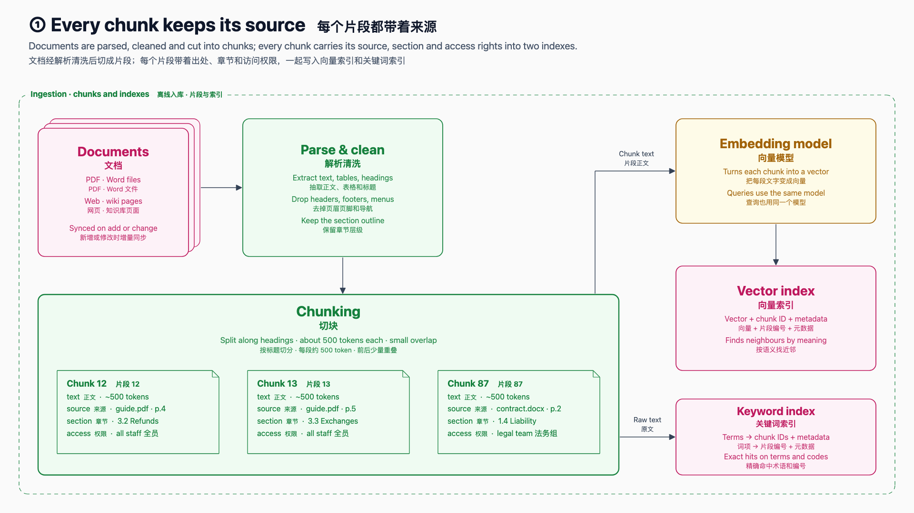

# 简约 Minimal
<!-- order: 2 -->
> 干净几何线条 + 圆角卡片 + 无衬线 UI 字体 + 近白底，像产品发布会或设计系统文档

适合：产品介绍、对外发布、方案评审、客户演示。信息密度高时依然清爽。

## 视觉要素

| 要素 | 取值 |
|---|---|
| 背景 | 近白 `#fafafa` |
| 形状 | 精确几何：`roughness 0`、单笔描边（约为手绘风的 0.72 倍粗）、14px 圆角矩形、极浅色填充 |
| 字体 | 系统 UI 无衬线（system-ui / Segoe UI / Helvetica Neue），中文 PingFang SC / 微软雅黑 / Noto Sans SC |
| 箭头 | 石板灰 `#334155` 细线 + 实心三角箭头 |
| 分区框 | 18px 圆角虚线框，无填充 |
| 通道 / 气泡 | 胶囊形长条、圆角气泡 |
| 强调 | 主角框加大、描边加粗（`strokeWidth: 3` → 实际约 2.2px） |
| 卡片 | 浅灰描边白卡；毛玻璃为蓝 → 白渐变 |

## 9 个色槽

| 槽 | 描边 = 框内文字 | 填充 | 对比度 |
|---|---|---|---|
| `C.user` | `#1d4ed8` 蓝 | `#eff6ff` | 6.2 |
| `C.im` | `#0f766e` 青 | `#effcf9` | 5.2 |
| `C.agent` | `#c2410c` 橙 | `#fff4ea` | 4.8 |
| `C.subagent` | `#a16207` 琥珀 | `#fefbe8` | 4.7 |
| `C.llm` | `#6d28d9` 紫 | `#f5f3ff` | 6.5 |
| `C.tools` | `#15803d` 绿 | `#effbf2` | 4.7 |
| `C.memory` | `#be185d` 玫红 | `#fdf2f8` | 5.5 |
| `C.external` | `#475569` 石板灰 | `#f1f5f9` | 6.9 |
| `C.error` | `#b91c1c` 红 | `#fef2f2` | 5.9 |

通用色：箭头 `#334155`，标题 `#0f172a`，副标题 `#475569`，注释 `#64748b`。

## 本风格的额外规则

- `restyle()` 把所有 rough.js 调用（包括 `main()` 里直接写的 `rc.line(..., { roughness: 1.4 })`）强制为 `roughness 0`、单笔、`solid` 填充，所以从别的风格搬来的 `main()` 也是干净线条。
- 圆角框是以 `Z` 结尾的 `rc.path`，`build_deck.py` 把它当闭合形状（节点）处理。
- 无衬线拉丁字母比 Times 宽约 10–15%：框内英文要留余量，长副标题控制在一行内。
