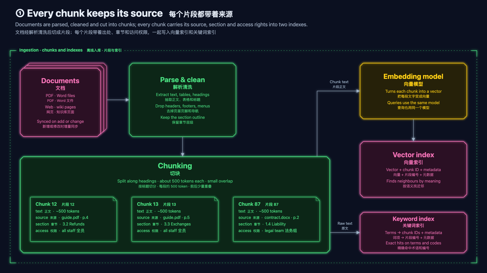

# 暗色科技 Neon
<!-- order: 3 -->
> 深海军蓝底 + 霓虹描边与柔光 + 切角面板 + 无衬线字体，像监控大屏或科技发布会

适合：AI / 基础设施 / 安全 / 数据平台主题，暗场投影，录屏视频。

## 视觉要素

| 要素 | 取值 |
|---|---|
| 背景 | 深海军蓝 `#0b1020` |
| 形状 | `roughness 0`、单笔描边、12px 切角（HUD 面板）、同色相深色填充 |
| 发光 | 每个形状按自己的描边色发光：图里是 canvas `shadowBlur 9`，deck 里是 `C.glow` = `drop-shadow(0 0 5px …)` |
| 字体 | 系统 UI 无衬线，中文 PingFang SC / 微软雅黑 / Noto Sans SC |
| 箭头 | 冷灰蓝 `#9fb3c8` 细线 + 实心三角 |
| 分区框 | 细点虚线 + 四角加粗括角 |
| 卡片 | 青色描边深色半透明卡；毛玻璃为青 → 靛 → 深蓝渐变 |

## 9 个色槽

| 槽 | 描边 = 框内文字 | 填充 | 对比度 |
|---|---|---|---|
| `C.user` | `#60a5fa` 电光蓝 | `#0f1d3a` | 6.6 |
| `C.im` | `#2dd4bf` 青 | `#0a2629` | 8.5 |
| `C.agent` | `#fb923c` 霓虹橙 | `#2a170c` | 7.6 |
| `C.subagent` | `#facc15` 黄 | `#262109` | 10.5 |
| `C.llm` | `#a78bfa` 紫 | `#1c1736` | 6.3 |
| `C.tools` | `#4ade80` 绿 | `#0c2617` | 9.2 |
| `C.memory` | `#f472b6` 品红 | `#2b1024` | 6.6 |
| `C.external` | `#94a3b8` 钢灰 | `#151c2b` | 6.6 |
| `C.error` | `#f87171` 红 | `#2d1114` | 6.3 |

通用色：箭头 `#9fb3c8`，标题 `#e6edf7`，副标题 `#9aa8bd`，注释 `#8393ab`。

## 本风格的额外规则

- 暗底：`main()` 里不要写死白色或黑色文字 / 填充，一律用 `C.title`、`C.caption`、`C.<slot>`、`LABEL_BG`。
- 发光会让很近的两个框糊在一起：框与框之间留 ≥ 24px。
- 二维码等图片放在白色方块里（`fill: '#ffffff'`），否则手机扫不出。
- 每个形状一层 `drop-shadow` 滤镜：deck 的形状数超过约 400 时，转场在低配机器上可能掉帧；录视频不受影响（逐帧截图）。
