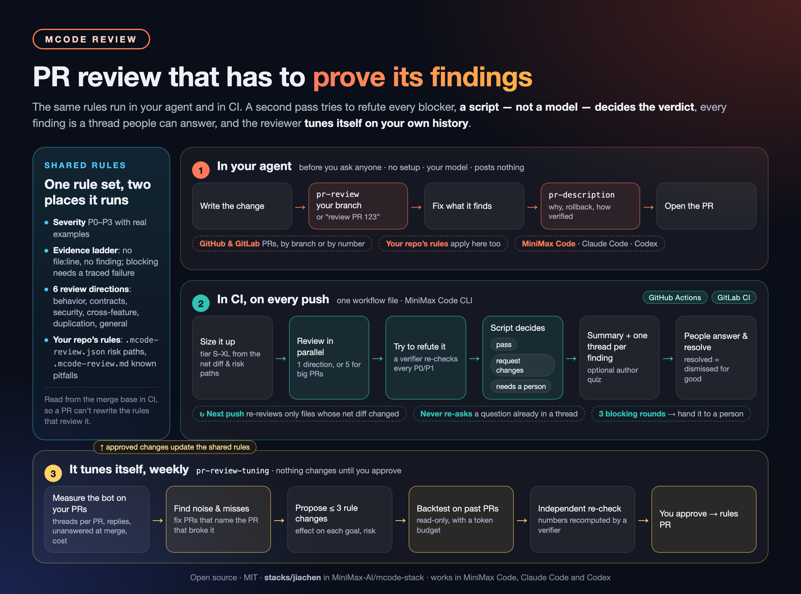

# jiachen

<p align="center">
  
</p>

The stack of Jiachen, an engineer on MiniMax Code. Its centerpiece is
**MCode Review**, the PR reviewer our team runs on its own merge requests,
published with everything it needs to run on yours. Two smaller skills come
along: one that keeps lifting me out of the agent loop, and one that turns
notes into posts and short videos.

## MCode Review: PR review that has to prove its findings

Getting a model to comment on a diff is easy. Getting a reviewer that people
still read after the hundredth PR is not: it has to be right when it blocks,
stay quiet when it has nothing, and stop asking what was already answered.
MCode Review is built around that.

- **A finding is a claim, and claims need evidence.** Every finding carries a
  severity (P0 to P3) and an evidence level. No file and line, no finding. To
  block, it needs a traced failure path, and a second, separate pass tries to
  refute it first.
- **A script, not a model, decides the verdict.** `pass`, `request changes`
  or `needs a person` comes from fixed rules in
  [`ci/core/verdict.mjs`](ci/core/verdict.mjs), not from how sure a model
  sounds. A round where part of the change went unreviewed never passes.
- **Threads are the memory.** Each finding or question is one thread. Resolve
  it and it stays dismissed; fix the code and the bot closes it, but only
  after the direction that raised it has looked at that file again. It never
  asks a question that is already in a thread.
- **It reviews what changed.** Results are kept per file by a fingerprint of
  that file's net diff: a clean rebase costs nothing, and a push re-reviews
  only the files it touched.
- **Depth scales with the PR.** Small PRs get one pass. Large ones get five
  directions in parallel: behavior, contracts and data, security and
  permissions, cross-feature impact, duplication.
- **Your repository's rules, protected.** Risk paths go in
  `.mcode-review.json` and known pitfalls in `.mcode-review.md`, in your own
  repository. CI reads both from the merge base, like `AGENTS.md`, so a PR
  cannot rewrite the rules that review it.
- **It knows when to stop.** Three blocking rounds in a row turn into "needs
  a person": the argument goes to people instead of two agents taking turns.
- **It tunes itself, and you sign off.** `pr-review-tuning` measures the
  reviewer on your own PRs, proposes at most three rule changes, backtests
  them on past PRs with known bugs, and changes nothing until you approve.

## Two ways to use it

**1. In your agent, before you ask anyone.** No setup: install the stack (see
[Install](#install)) and, in a checkout, say:

- "Review this branch with pr-review", or "Review PR 123 with pr-review". It
  works with GitHub pull requests and GitLab merge requests: it fetches the PR
  head, diffs it against its target and reports blocking findings, questions
  for a person and suggestions.
- "Review it with pr-review, security and permissions only" for chosen
  directions.
- "Draft the PR description with pr-description".

It uses your own session's model, posts nothing, and applies your
repository's `.mcode-review.json` and `.mcode-review.md` when they exist.

**2. In CI, on every PR, for the whole team.** One workflow file, pinned to a
commit of this repository.

- **GitHub Actions.** Copy [`ci/github/mcode-review.yml`](ci/github/mcode-review.yml)
  to `.github/workflows/mcode-review.yml`, put a commit of this repository
  in its `MCODE_REVIEW_PLUGIN_REF`, add the secret `MCODE_REVIEW_API_KEY`
  and the variable `MCODE_REVIEW_BASE_URL` (for example
  `https://api.minimax.io/anthropic/v1`), and open a PR.
- **GitLab CI.** Copy [`ci/gitlab/review.gitlab-ci.yml`](ci/gitlab/review.gitlab-ci.yml)
  to `.gitlab/mcode-review.gitlab-ci.yml`, paste the job in
  [`ci/gitlab/dispatch.gitlab-ci.yml`](ci/gitlab/dispatch.gitlab-ci.yml) into
  your `.gitlab-ci.yml` with the same commit, set `MCODE_REVIEW_API_KEY`,
  `MCODE_REVIEW_BASE_URL` and `MCODE_REVIEW_GITLAB_TOKEN`, and open a merge
  request.

Or let your agent do it: "Set up MCode Review on this repository with
pr-review-ci". Both scenarios run the same `pr-review` rules, so a branch your
agent reviewed is judged the same way in CI.

Then, once a week if you like: "Run pr-review-tuning on last week's PRs".

## What a review looks like

The bot keeps one summary comment per PR up to date:

> **MCode Review: 🔧 Changes requested** (shadow phase: comments only, does not block merging)
>
> 1 blocking, 1 for a person, 2 suggestions.
>
> Reviewed `4f2c9e1a7b`, round 2, tier L, 14 files kept from the previous round.
>
> **Changes needed**
> 1. **[P1·defect] A retried payment is charged twice after a gateway timeout** (F-3c91a2, behavior) `src/billing/charge.ts:88`
>
> **For a person**
> - **Does the new refund worker start in every environment, or only where its queue exists?** (new this round)
>
> **Suggestions**
> 1. **[P2·maintainability] `formatAmount` copies the rounding rule of `money.ts`** (F-91be07, duplication) `src/billing/format.ts:12`
> 2. **[P2·defect] An empty coupon list skips the minimum-amount check** (F-0a4f3d, general) `src/cart/total.ts:41`

Each of those is also a thread on the PR, anchored on the line when it can be,
with the failure path, a suggestion and whether the verifier confirmed it.
Answer in the thread; resolve it to dismiss it. Set `MCODE_REVIEW_LANGUAGE` to
`zh` and everything the bot posts is in Simplified Chinese.

Out of the box it runs `MiniMax-M3.1-Flash` through the MiniMax Code CLI;
[`ci/config/models.json`](ci/config/models.json) takes any model your
endpoint serves.

| Skill | What it does |
| --- | --- |
| [`pr-review`](skills/pr-review/SKILL.md) | Reviews a branch or a PR (GitHub or GitLab) against its target with the severity scale, the evidence ladder and one checklist per direction. CI runs the same skill. |
| [`pr-description`](skills/pr-description/SKILL.md) | Drafts or checks a PR description: background, changes, behavior changes, out of scope, verification, rollback, not done, related. |
| [`pr-review-ci`](skills/pr-review-ci/SKILL.md) | Connects a repository to the CI review on GitHub Actions or GitLab CI, upgrades or rolls back the pinned commit, and changes rules, models, language or the quiz. |
| [`pr-review-tuning`](skills/pr-review-tuning/SKILL.md) | The weekly self-tuning loop: measure the reviewer on your PRs, find noise and misses, propose at most three rule changes, backtest them, re-check the numbers independently, and wait for your approval. |
| [`pr-quiz`](skills/pr-quiz/SKILL.md) | Rules for the optional author quiz: a few plain-language questions on why the change works and how it fails. CI uses it. |

How it decides, every setting, the security model and development notes:
[`docs/pr-review.md`](docs/pr-review.md).

## Also in this stack

| Skill | What it does |
| --- | --- |
| [`lifting-loops`](skills/lifting-loops/SKILL.md) | Find the loops where you keep acting as a manual step for your agents (retrying, judging output, approving, carrying context, starting the same task by hand) and turn each one into a concrete fix: delete a stale rule, change a skill or `AGENTS.md`, add a script, a skill or a scheduled task. Reads local MiniMax Code, Claude Code and Codex sessions; keeps its ledger in a gitignored `private/` folder. |
| [`making-content`](skills/making-content/SKILL.md) | Rewrite an AI-sounding Chinese draft in a restrained voice, make a Xiaohongshu (小红书) image post from scratch, or turn material into a 60–180 s vertical video with real sources, voice-over and captions. |

How these fit into a working day: [`WORKFLOW.md`](WORKFLOW.md).

## Install

In Claude Code, one command installs this stack. In a shell:

```bash
claude plugin install jiachen --marketplace MiniMax-AI/mcode-stack
```

Inside a session:

```bash
/plugin install jiachen --marketplace MiniMax-AI/mcode-stack
```

Older Claude Code can add the marketplace first, then install:

```bash
/plugin marketplace add MiniMax-AI/mcode-stack
/plugin install jiachen@mcode-stack
```

In Codex, add the marketplace, then install from the Plugins Directory or the CLI:

```bash
codex plugin marketplace add MiniMax-AI/mcode-stack
codex plugin add jiachen@mcode-stack
```

In MiniMax Code, copy this whole directory into the local plugin directory
shown by `mcode plugin marketplace list`, or copy single skills into
`~/.agents/skills/`. See the [repository README](../../README.md#quick-start).

## Requirements

- MCode Review, local: `git`; `gh` or `glab` are used when installed, to
  find a PR's target branch. CI: GitHub Actions or GitLab CI runners that can
  run Node 22 and reach github.com, the npm registry and your model endpoint.
  `pr-review-tuning` needs Node 22 and a token that can read your PRs.
- `lifting-loops`: Python 3, standard library only.
- `making-content`: text rewriting needs nothing. Video needs Python 3 with
  `pip install -r skills/making-content/requirements.txt`, Playwright's
  Chromium, `ffmpeg` and a CJK font; see
  [`video-pipeline.md`](skills/making-content/references/video-pipeline.md).
  A cloned voice is optional and needs the user's own Volcengine key.

Personal data stays local: `making-content` reads before/after samples from a
gitignored `test-cases/` folder, `lifting-loops` writes everything it learns
about you to a gitignored `private/` folder, and `pr-review-tuning` keeps its
weekly data in a working folder you keep out of git.

## Origin

MCode Review started as the review bot our team runs on its own merge
requests; this is its public edition, released under MIT, with our internal
rule packs replaced by your repository's own `.mcode-review.json` and
`.mcode-review.md`.

`lifting-loops` and `making-content` are maintained in
[yujiachen-y/dotfiles](https://github.com/yujiachen-y/dotfiles/tree/main/agents/skills), where changes land
first; this stack carries a copy with personal examples replaced by neutral
ones, released under MIT. The dotfiles repository has a few more skills (for
example `making-flashcards` for Anki and `review-skill` for auditing skills)
and its own marketplace for Claude Code and Codex:

```bash
/plugin marketplace add yujiachen-y/dotfiles      # Claude Code
npx skills add yujiachen-y/dotfiles --skill <name>
```
