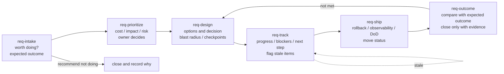

# req-tpm

English | [中文](README_ZH.md)

`req-tpm` lets the person who raises a requirement act as its TPM, together
with their own agent. Every product or technical requirement gets a doc, a
work item and someone following it, from intake to the outcome review, so
nothing gets dropped quietly.

The requirement body lives in a Feishu doc. Status and flow live in Meegle
(Feishu Project). Each skill installs and runs on its own, and keeps both
sides in step.

> **v0, optional.** This stack has not yet been run against a real Meegle
> space. The field mapping separates keys confirmed in the `meegle` CLI's own
> docs from project-specific fields, roles and states, which are assumptions
> until you look them up in your space.

## Lifecycle



| Phase | Skill | Writes to doc sections |
| --- | --- | --- |
| Intake | [`req-intake`](skills/req-intake/SKILL.md) | 1–3 |
| Prioritize | [`req-prioritize`](skills/req-prioritize/SKILL.md) | 4 |
| Design | [`req-design`](skills/req-design/SKILL.md) | 5–6 |
| Track | [`req-track`](skills/req-track/SKILL.md) | 7 |
| Ship | [`req-ship`](skills/req-ship/SKILL.md) | 8 |
| Outcome | [`req-outcome`](skills/req-outcome/SKILL.md) | 9 |

## Rules we follow

- The expected outcome is fixed at intake: metric, baseline, target, how we
  measure it, and the observation window. The requirement is judged against it
  at the end.
- The requester recommends; the owner decides priority. The agent does not
  change the priority of someone else's requirement.
- A stale item is information. It goes to the top of the report. We don't
  nudge people automatically, and we don't stay silent either.
- Shipping is not done. A requirement closes only with evidence of the
  outcome.
- Anything visible to others (comments, @-mentions, status transitions) is
  shown to the requester first and runs only after they confirm.

## Dependencies

- The `meegle` CLI (Feishu Project), logged in. Fields and states are in
  [`templates/meegle-field-mapping.md`](templates/meegle-field-mapping.md);
  replace every entry marked as an assumption before the first real write.
- `lark-cli`, reading and writing Feishu docs as the user (`--as user`).
- The requirement doc template:
  [`templates/requirement-doc.md`](templates/requirement-doc.md).

## Usage

Install the whole stack:

```bash
claude plugin install req-tpm --marketplace MiniMax-AI/mcode-stack
codex plugin add req-tpm@mcode-stack     # after: codex plugin marketplace add MiniMax-AI/mcode-stack
scripts/install.sh req-tpm               # from a clone of this repository
```

Or copy one skill, such as `stacks/req-tpm/skills/req-intake`, into
`~/.agents/skills/`. Start with `/req-intake` when someone raises a
requirement. [`WORKFLOW.md`](WORKFLOW.md) lists which skill fits which moment.
