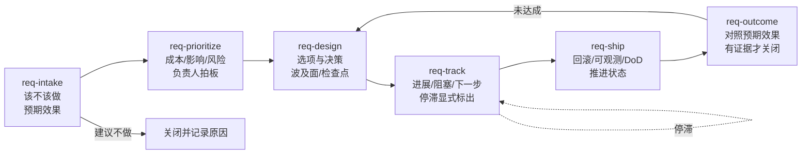

# req-tpm

[English](README.md) | 中文

让需求提出人和自己的 Agent 一起，当这个需求的 TPM：从提出到效果验收，全程有文档、有工作项、有人在跟，不会悄悄丢掉。

需求正文放飞书文档，状态和流转放飞书项目（Meegle）。每个 skill 都可以单独装、单独用，同时维护两边。

## 生命周期

| 阶段 | Skill | 产出写到文档哪一节 |
| --- | --- | --- |
| 受理 | `req-intake` | 1–3 |
| 排期 | `req-prioritize` | 4 |
| 方案 | `req-design` | 5–6 |
| 跟进 | `req-track` | 7 |
| 上线 | `req-ship` | 8 |
| 验收 | `req-outcome` | 9 |

## 几条规则

- 预期效果在受理时就写死：指标、基线、目标、测法、观察窗口。最后用它验收。
- 提出人提建议，负责人做优先级决定。Agent 不改别人需求的优先级。
- 停滞本身是一条信息：报告里置顶，不自动催人，也不沉默。
- 上线不等于完成。只有拿到效果证据才关闭。
- 对外可见的写操作（评论、@人、状态流转）先给提出人看，确认后执行。

## 依赖

- `meegle` CLI（飞书项目），已登录；字段和状态见 [`templates/meegle-field-mapping.md`](templates/meegle-field-mapping.md)。
- `lark-cli`，以用户身份（`--as user`）读写飞书文档。
- 需求文档模板：[`templates/requirement-doc.md`](templates/requirement-doc.md)。

日常怎么挑 skill，见 [`WORKFLOW_ZH.md`](WORKFLOW_ZH.md)。

> v0：还没在真实的 Meegle 空间里跑过。字段映射里标「假设」的部分，要先在你的空间里现查再替换。
