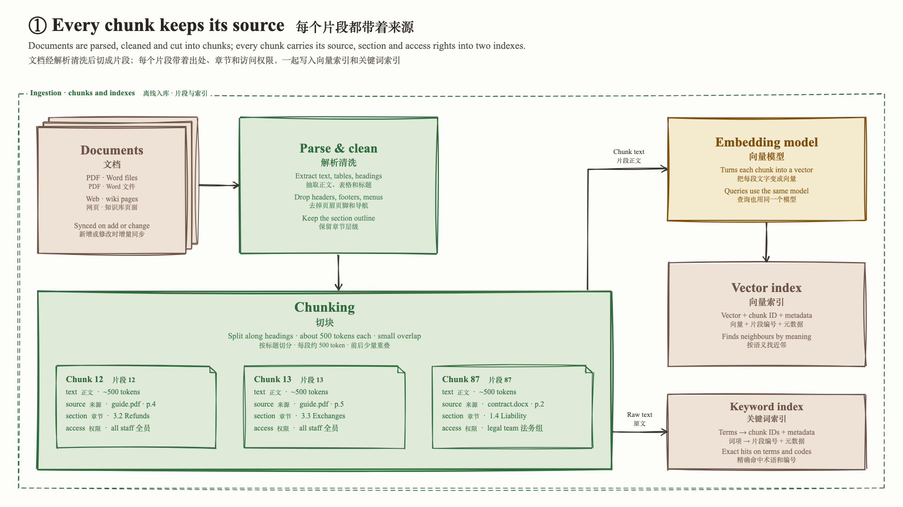
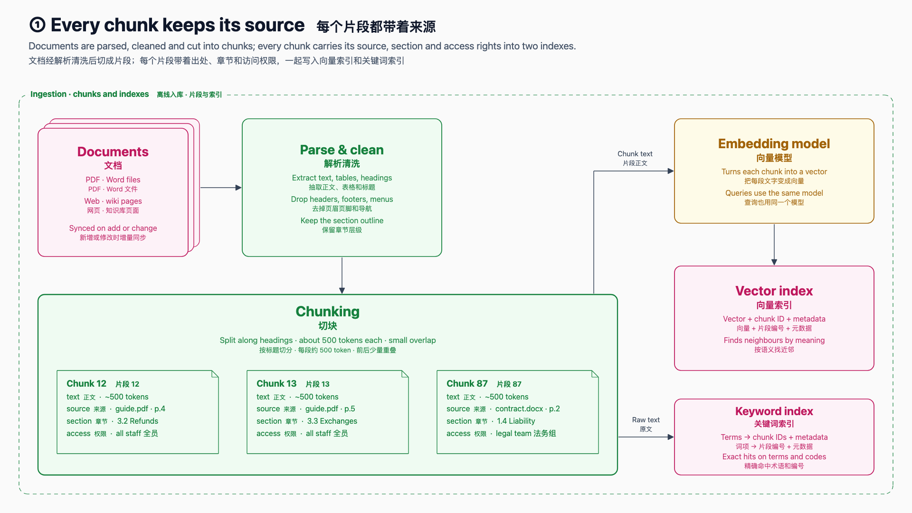
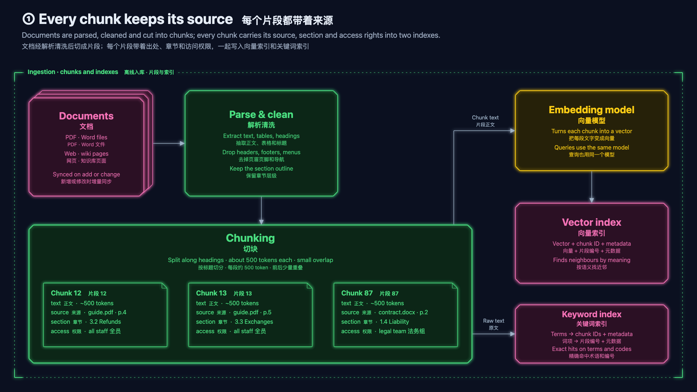
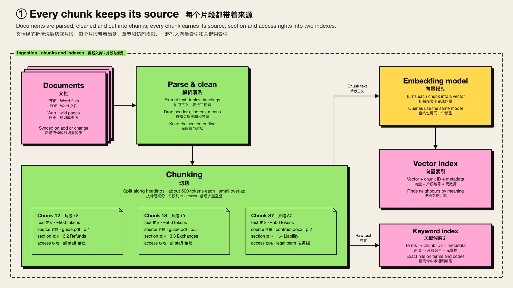

# youfang

The stack of Youfang, an engineer on MiniMax Code: one skill that turns an
architecture or flow walkthrough into a Keynote-style **Magic Move** slide
deck. Every slide is a diagram seen through a camera, and the boxes, labels
and titles two slides share morph and fly instead of cross-fading. The agent
first renders one sample slide in each of four styles; you pick one and it
builds the whole deck in that style.

| A · Hand-drawn | B · Minimal |
| --- | --- |
|  |  |
| **C · Dark neon** | **D · Neo-brutalist** |
|  |  |

## Install

In Claude Code, one command installs this stack. In a shell:

```bash
claude plugin install youfang --marketplace MiniMax-AI/mcode-stack
```

Inside a session:

```bash
/plugin install youfang --marketplace MiniMax-AI/mcode-stack
```

Older Claude Code can add the marketplace first, then install:

```bash
/plugin marketplace add MiniMax-AI/mcode-stack
/plugin install youfang@mcode-stack
```

In Codex, add the marketplace, then install from the Plugins Directory or the CLI:

```bash
codex plugin marketplace add MiniMax-AI/mcode-stack
codex plugin add youfang@mcode-stack
```

In MiniMax Code, copy this whole directory into the local plugin directory
shown by `mcode plugin marketplace list`, or copy the skill into
`~/.agents/skills/`. See the [repository README](../../README.md#quick-start).

| Skill | What it does |
| --- | --- |
| [`magic-move-deck`](skills/magic-move-deck/SKILL.md) | Plan the storyline (cover → overview → per topic: zoom into its region, detail diagram, three spotlights → overview → closing card), draw one detail diagram, render it in four styles for you to choose, then draw the remaining diagrams in that style and build one offline 1920×1080 HTML deck. Shared elements are matched by name across slides. Screenshots every slide and transition to check the result; optional 4K / 1080p video with background music. |

A complete example deck (a RAG knowledge assistant, 19 slides) with its
sources, configuration and previews is in
[`skills/magic-move-deck/examples/rag-assistant/`](skills/magic-move-deck/examples/rag-assistant/).

## Requirements

- Python 3 and Playwright's Chromium:
  `pip install playwright && playwright install chromium`.
- `ffmpeg`, only for video export.
- Network access while diagrams are rendered (rough.js from jsDelivr). The
  built deck is a single file that works offline.
- Fonts: Times New Roman and a Songti font for the hand-drawn style (shipped
  with macOS and Windows); the other styles use the system UI font with
  PingFang SC, Microsoft YaHei or Noto Sans SC for Chinese.

How this fits into a working day: [`WORKFLOW.md`](WORKFLOW.md). Third-party
credits: [`NOTICE.md`](NOTICE.md).
